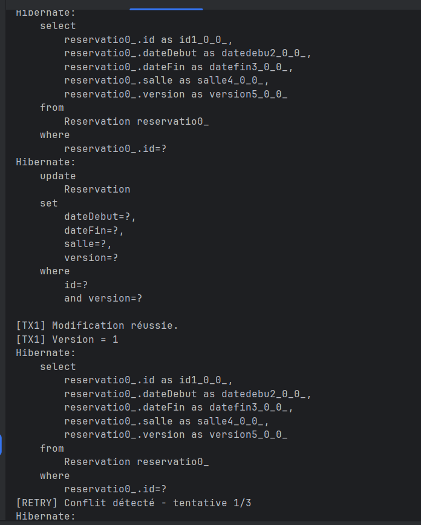
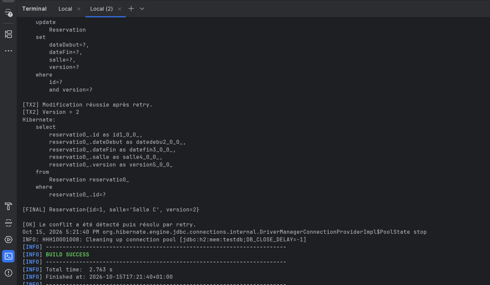

# TP — Verrouillage optimiste avec JPA / Hibernate

Ce TP simule deux transactions qui modifient la même réservation avec JPA et Hibernate.
Le conflit est détecté grâce à `@Version`, puis résolu par un retry.

## Verrouillage optimiste

### Détection du conflit

TX1 passe à la version 1, puis la modification de TX2 déclenche un conflit.

## Retry après conflit

### Résolution par retry

Après rechargement de la réservation, TX2 réussit et la version finale passe à 2.

## Résultat

- Conflit détecté.
- Retry effectué.
- TX2 réussie après retry.
- Version finale = 2.
- BUILD SUCCESS.
